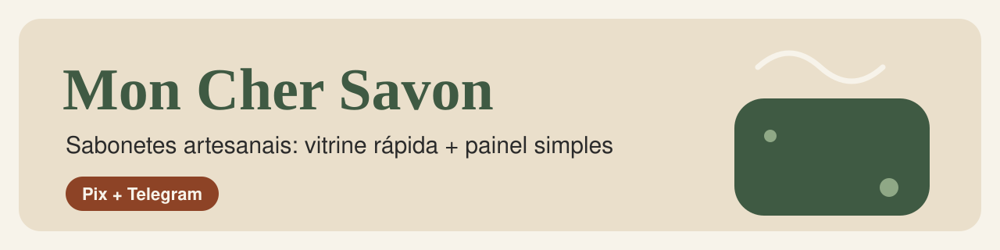
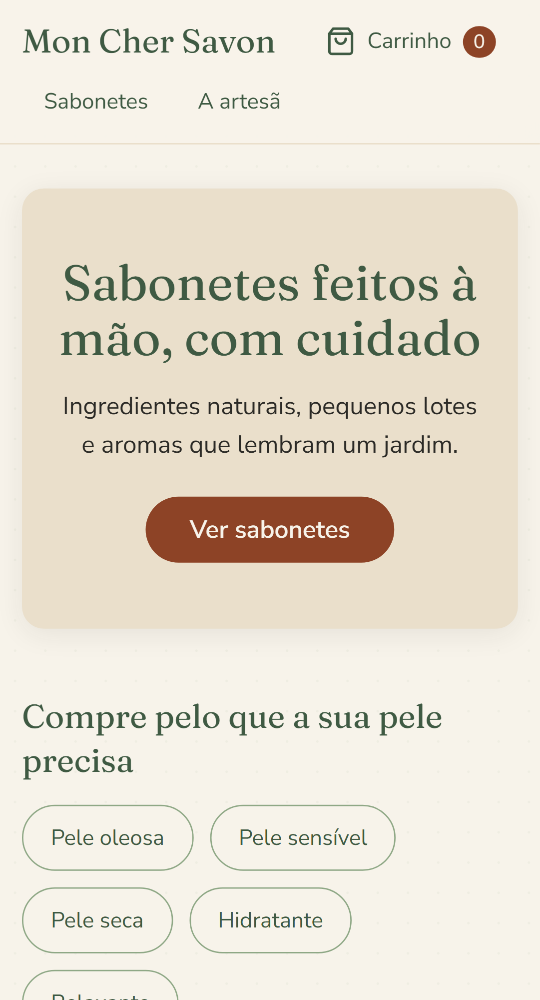
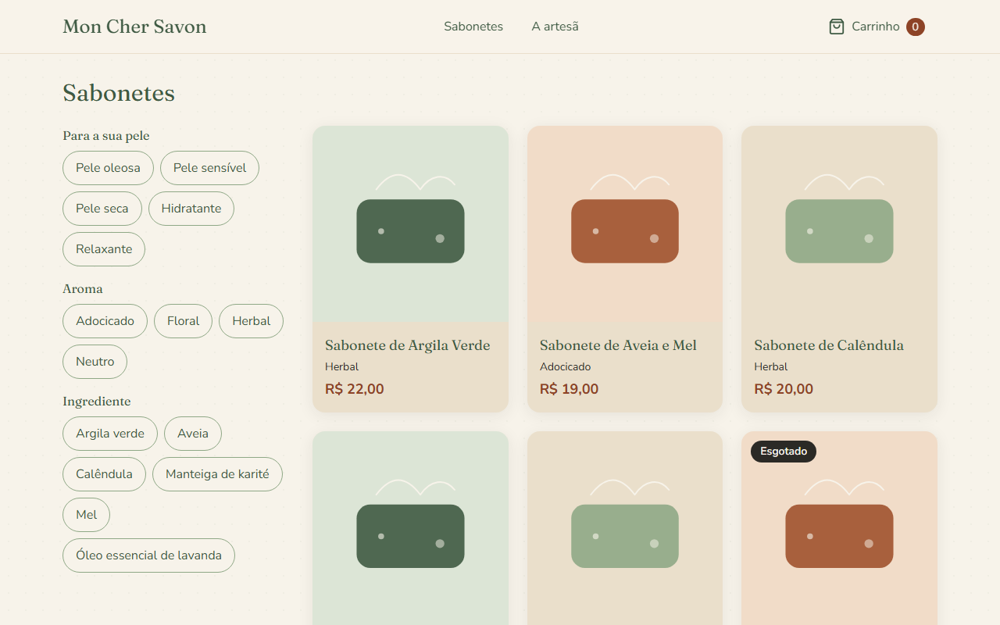
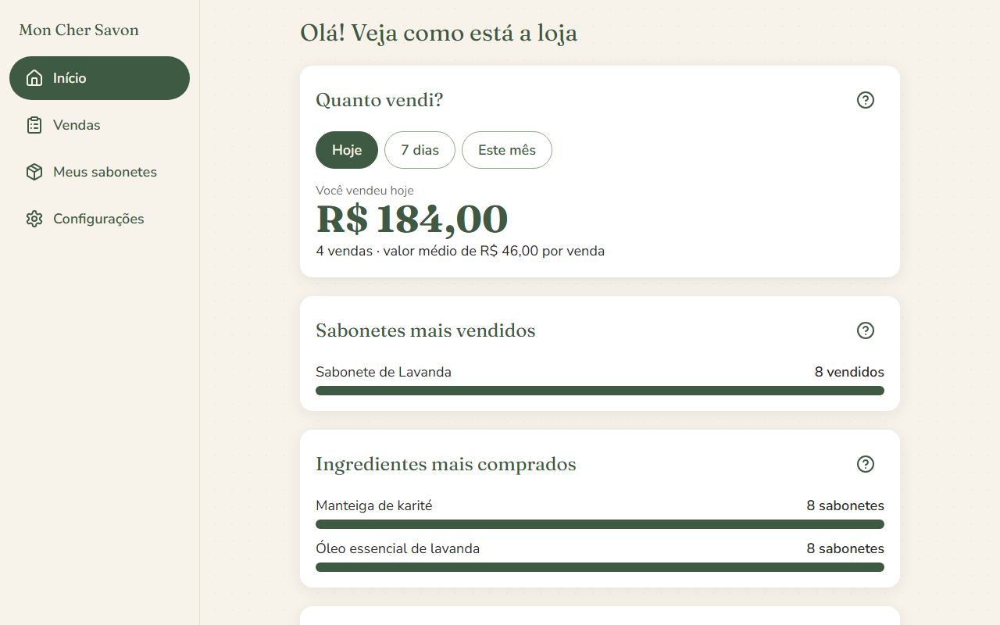
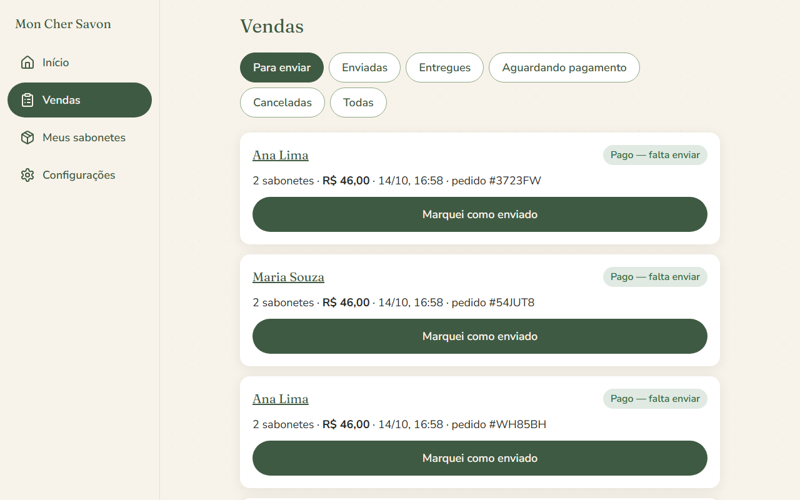
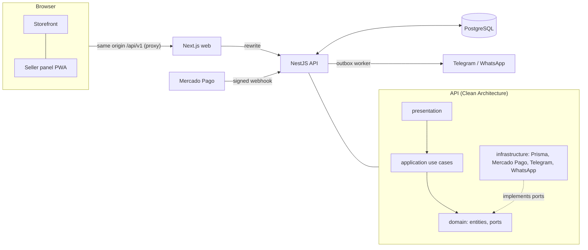

# Mon Cher Savon




Artisanal soap e-commerce for a real seller: a **mobile-first storefront** (Pix checkout, order tracking)
and a **dashboard simple enough for a non-technical seller**, who gets a Telegram/WhatsApp message on
every sale. Built as a portfolio-grade monorepo: Clean Architecture, TDD, accessibility (WCAG 2.2 AA)
and security checked in CI.

> Replace `OWNER` in the badge above with your GitHub user or organization.

## Highlights

- **Checkout without sign-up**: cart in the browser, address filled from the CEP, Pix through Mercado Pago.
  An order only becomes _paid_ after the API asks Mercado Pago for the payment (signed, idempotent webhook).
- **Never oversells**: stock is taken in the same transaction that confirms the payment, with row locks
  (tested with two payments racing for the last item).
- **Reliable alerts**: the sale and an outbox event are saved together; a worker sends the Telegram/WhatsApp
  message with retries. A channel outage never undoes a sale.
- **Seller dashboard for non-experts**: four always-visible tabs, big buttons, plain words, undo for
  destructive actions, a 4-step product wizard, revenue/best sellers/ingredients with the number written
  beside each bar. Installable as an app (PWA).
- **Quality gates**: 90%+ coverage on domain/application, real-Postgres integration tests, Playwright E2E on
  phone and desktop with axe accessibility checks, Lighthouse (mobile, slow 4G) with budgets.

| Lighthouse (mobile, simulated slow 4G) | Performance | Accessibility | Best practices | SEO | LCP     |
| -------------------------------------- | ----------- | ------------- | -------------- | --- | ------- |
| Home, catalog, product, about          | 97–99       | 100           | 96–100         | 100 | ≈ 2.0 s |

## Screenshots

| Storefront (phone)                                           | Catalog (desktop)                                                 |
| ------------------------------------------------------------ | ----------------------------------------------------------------- |
|  |  |

| Seller dashboard (desktop)                               | Sales list (desktop)                                 |
| -------------------------------------------------------- | ---------------------------------------------------- |
|  |  |

Regenerate them with `SCREENSHOTS=1 pnpm --filter @mon-cher-savon/e2e exec playwright test 04-screenshots`
(they come from the E2E stack with demo data).

## Stack

TypeScript everywhere · **Next.js 15** (App Router) + Tailwind + Radix · **NestJS** · **PostgreSQL** + **Prisma** ·
**Zod** shared contracts · Mercado Pago · Telegram Bot API and WhatsApp Cloud API · Vitest, Testing Library,
Supertest, Testcontainers, MSW, Playwright, axe · pnpm + Turborepo · Docker.



Decisions are recorded in [`docs/adr`](docs/adr).

## Run it (3 commands)

```bash
pnpm install
docker compose up -d                 # PostgreSQL
cp .env.example .env                 # then fill SESSION_SECRET (>= 32 chars); use PAYMENT_MODE=fake to try the UI
pnpm --filter @mon-cher-savon/api db:deploy && pnpm --filter @mon-cher-savon/api db:seed
ADMIN_EMAIL=ana@example.com ADMIN_PASSWORD=choose-a-long-password pnpm --filter @mon-cher-savon/api db:seed-admin
pnpm dev                             # web on :3000, API on :3001 (Swagger at /api/docs in development)
```

The panel is at `/painel`. Without Mercado Pago credentials use `PAYMENT_MODE=fake` (the order page shows a fake
Pix code; payments cannot be confirmed in that mode).

## Tests

```bash
pnpm test                 # unit + component tests          pnpm test:cov   # + coverage gate (90%)
pnpm --filter @mon-cher-savon/api test:int    # Postgres in a container (Docker required)
pnpm --filter @mon-cher-savon/e2e exec playwright install chromium
pnpm --filter @mon-cher-savon/e2e test        # full stack, phone + desktop, mocked Mercado Pago/Telegram/ViaCEP
pnpm --filter @mon-cher-savon/e2e lighthouse  # performance / accessibility / SEO budgets
```

No test calls a real external service. The E2E suite uses its own database (`..._e2e`) and refuses to touch any
other.

## Project layout

```text
apps/web        Next.js: storefront + /painel
apps/api        NestJS: domain / application / infrastructure / presentation
packages/contracts   Zod schemas and types shared by web and API (+ signed-session helper)
packages/ui-tokens   Botanical design tokens (contrast-tested)
e2e             Playwright + Lighthouse + local mocks of external services
docs            ADRs, notifications, deploy guide, launch checklist
```

## Docs

[Deploy](docs/deploy.md) · [Launch checklist](docs/launch-checklist.md) · [Sale notifications](docs/notifications.md) ·
[Security policy](SECURITY.md)

## Português

**Mon Cher Savon** é uma loja de sabonetes artesanais com vitrine pensada para o celular (pagamento por Pix, página de
status do pedido) e um painel simples para a vendedora: ela vê o que vendeu, o que precisa enviar e o que está acabando,
e recebe um aviso no Telegram ou WhatsApp a cada venda.

- **Rodar:** `pnpm install`, `docker compose up -d`, copie `.env.example` para `.env` e rode `pnpm dev` (passos acima).
- **Testes:** `pnpm test`, `pnpm test:cov`, integração com Postgres e E2E com Playwright (comandos acima).
- **Publicar:** veja [`docs/deploy.md`](docs/deploy.md) e a lista do que depende de uma pessoa em
  [`docs/launch-checklist.md`](docs/launch-checklist.md) (contas, Mercado Pago de produção, domínio, revisão jurídica das
  políticas, teste de usabilidade com a vendedora).

## License

MIT. Product photos and the shop brand are used only with the seller's permission; the demo uses free images and fake data.
